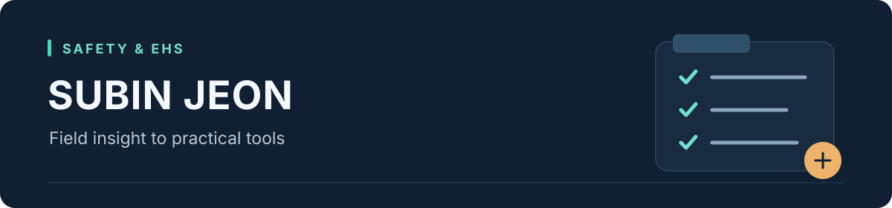

# 전수빈 · Safety & EHS Portfolio

**안전·소방 업무에서 필요한 정보를 정리하고, 직접 써볼 수 있는 웹앱으로 구체화합니다.**

소방공학을 전공하고 제조업 환경안전 업무를 경험했습니다. 사업장별 법규 확인과 소방점검 기록을 주제로, 업무의 요구사항과 화면 흐름을 기획하고 생성형 AI와 협업해 Python·Streamlit 프로토타입을 만들고 있습니다.

## 직접 살펴보기

### 01 · 사업장별 EHS 법령 검토 도우미

**사업장 제원 → 관련 법규 항목 → 근거·증빙 → 후속 조치 기록**

제조공정과 공장 신축·건설 현장을 선택하고, 인원·건물·물질·설비에 따라 확인할 항목을 정리합니다. 입력한 개정 원문과 사업장 정보를 비교해 추가로 확인할 조건도 보여줍니다.

- 시작 템플릿 **15종**, 제원이 채워진 가상 예제 **5개**, 등록 검토 항목 **40개**
- 담당자·기한·상태 기록, Excel·CSV 출력, JSON 저장·복원
- 조건·누락·예제·출력·화면 흐름을 검증하는 테스트 **47개**

**[웹앱 체험하기 ↗](https://ehs-system-dpxks.streamlit.app/) · [코드와 기획 내용](https://github.com/Safety-Bin/ehs-system)**

### 02 · QR 활용 소화기 점검 프로토타입

**현장 점검 입력 → 이상 항목 구분 → 관리자 화면 확인 → Excel 내보내기**

소화기에 부착한 QR 링크로 점검 화면을 여는 사용 장면을 기획했습니다. 현재는 공정·관리번호를 직접 입력하며, 한 브라우저 세션에서 점검자와 관리자의 화면 흐름을 체험할 수 있습니다.

- 소화기 외관·호스·압력 상태와 특이사항 입력
- 외관 불량 또는 압력 이상 기록을 별도 표로 확인
- 점검 이력 조회와 Excel 다운로드

**[웹앱 체험하기 ↗](https://smart-qr-system-runmm.streamlit.app/) · [코드와 기획 내용](https://github.com/Safety-Bin/smart-QR-system)**

## 프로젝트에서 맡은 일

| 단계 | 기획과 검토 내용 |
| --- | --- |
| 문제 정의 | 확인할 법규가 사업장마다 달라지는 점, 점검 입력과 취합이 분리되는 점에서 출발 |
| 요구사항 구성 | 사업장·설비 입력 항목, 점검 항목, 필요한 결과와 저장 방식을 구체화 |
| 사용 흐름 설계 | 처음 쓰는 사람을 위한 예제, 점검자·관리자 화면, 검토·기록·출력 순서 구상 |
| 구현과 개선 | 생성형 AI와 코드 구현을 협업하고, 미리보기와 실제 입력 흐름을 검토하며 개선 |

## 업무 기반

- **소방공학 전공** · 제조업 환경안전 업무 경험
- **산업안전기사** · **소방설비기사 기계·전기**
- 소방공사·설비 점검 지원, P&ID 현장 대조 및 MSDS 자료 정리 보조, 다국어 안전교육자료 제작 경험

각 저장소에는 구현한 기능과 사용 범위, 다음 개선 방향을 함께 정리했습니다. 두 웹앱은 개인 기획·학습용 프로토타입이며, 회사 도입이나 현장 효과를 측정한 프로젝트는 아닙니다.
